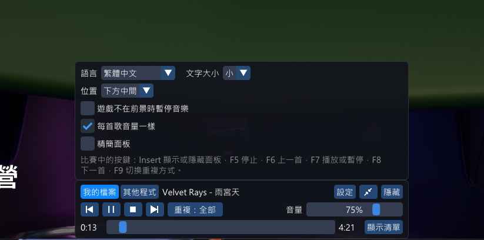
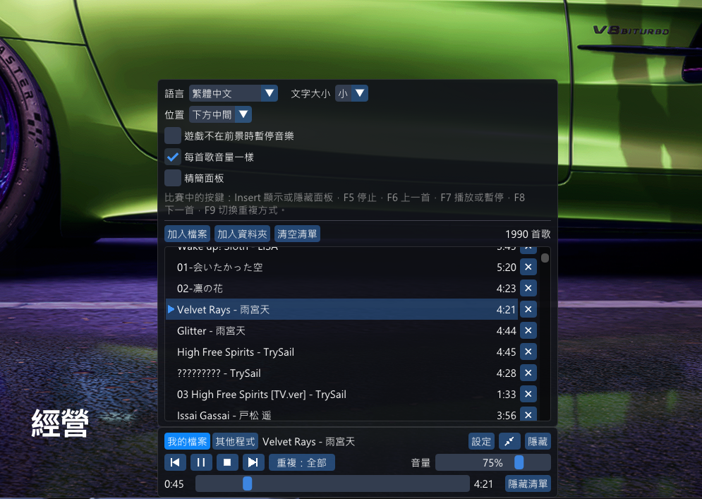
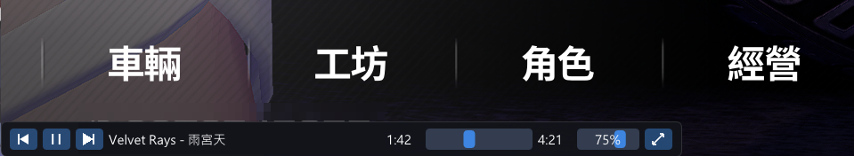
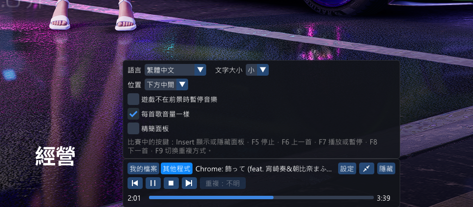

# Racing Master Mod

[繁體中文](#繁體中文) · [English](#english)

---

## 繁體中文

《巔峰極速》（Racing Master）PC 版的音樂面板。比賽時直接在遊戲裡放自己的歌，或控制 Spotify、瀏覽器正在播的音樂，不用切出遊戲。



這是玩家自己做的免費模組，跟網易沒有任何關係。它只在遊戲畫面上畫一個面板、播你的歌，不改遊戲檔案、不讀寫遊戲記憶體，也不連網路。

### 用之前請先看

- **遊戲並沒有允許加模組。**《巔峰極速》有反作弊，用了有可能被封號，請自己衡量。
- **新版本先用分身帳號試。**封號不一定馬上發生，今天沒事不代表以後沒事。
- **風險自負。**遊戲、電腦或帳號出了任何問題，作者都不負責（見 MIT 授權）。
- **遊戲更新後可能會失效。**遇到的話先移除，等新版本。
- 模組永遠不會想辦法躲過反作弊。遊戲要是擋下它，就到此為止。

### 安裝

1. 下載 **[racing-master-music-player.zip](https://github.com/NikuPAN/racing-master-mod/releases/latest/download/racing-master-music-player.zip)**（永遠是最新版）。也可以在這個頁面右邊的 **Releases**，找標著綠色 **Latest** 的 **Music player**。
2. 對 `.zip` 按右鍵，選「全部解壓縮」，裡面就有 `version.dll`。
3. 把遊戲和啟動器完全關掉。
4. 對遊戲捷徑按右鍵，選「開啟檔案位置」，再打開 `Binaries`、`Win64`。看得到 `g112-Win64-Shipping` 就對了。預設路徑是 `C:\Program Files (x86)\g112\Binaries\Win64`。
5. 把 `version.dll` 拖進去。Windows 問權限就按「繼續」；說已經有同名檔案（舊版）就選取代。
6. 照平常開遊戲。畫面下方出現提示後，按 **Insert** 打開面板。

只想聽自己的歌的話，到遊戲的聲音設定把音樂調低或關掉。

### 移除

關掉遊戲，刪掉 `Win64` 資料夾裡的 `version.dll` 就好。歌單和設定放在 `%LOCALAPPDATA%\RacingMasterMod`（貼到檔案總管的網址列就能打開），不要的話整個資料夾一起刪。

### 怎麼用

按 **Insert** 打開或收起面板。面板開著也能照樣開車：點在面板上只會操作面板，點在別的地方一樣交給遊戲。

面板最左邊的兩個按鈕切換音樂來源：

- **我的檔案**：播你電腦裡的歌。按「加入檔案」或「加入資料夾」，或者把歌複製到 `%LOCALAPPDATA%\RacingMasterMod\music`，每次開遊戲都會自動加進歌單。
- **其他程式**：控制 Spotify、瀏覽器這類正在播音樂的程式。按鈕變灰的話，代表那個程式不開放這項操作，滑鼠停在上面會說明原因。

重複按鈕旁邊是**隨機播放**（只用在我的檔案）：每首歌播過一次才會重複，很久沒聽的歌先播，同一個歌手不會連著出現。



「設定」裡可以換語言、文字大小和面板位置（四個角落、上方中間或下方中間），還有三個開關：

- **遊戲不在前景時暫停音樂**
- **每首歌音量一樣**：大聲和小聲的歌用差不多的音量播。每首歌第一次會在背景量一次音量。
- **精簡面板**：縮成一列，只留播放按鈕、歌名、進度和音量，適合放在畫面邊角。





比賽中可以用的按鍵，面板收起來也有效：

| 按鍵 | 功能 |
|---|---|
| Insert | 打開或收起面板 |
| F5 | 停止 |
| F6 | 上一首 |
| F7 | 播放或暫停 |
| F8 | 下一首 |
| F9 | 重複方式：不重複、這一首、整個清單 |
| F10 | 開關隨機播放 |

鍵盤上的多媒體鍵也可以控制你的歌。

### 支援的格式

MP3、FLAC、WAV、OGG、Opus 和 M4A（AAC、Apple Lossless）。不支援 `.webm`，請先轉成 `.opus`。Windows「N」版本要先安裝「媒體功能套件」才能播 M4A。

### 遇到問題

- **按 Insert 沒反應：**檔名要剛好是 `version.dll`（不是 `version (1).dll`），而且要跟 `g112-Win64-Shipping` 放在同一個資料夾。
- **面板一閃一閃：**到 NVIDIA App 把這個遊戲的 Smooth Motion 關掉。
- **其他問題：**回報時請附上 `%LOCALAPPDATA%\RacingMasterMod\mod.log`。紀錄檔裡有你歌曲的檔名和資料夾路徑，路徑裡會看到你的 Windows 使用者名稱。

### 進階設定

大部分設定在面板裡就能改。想換按鍵或面板模式，就在 `%LOCALAPPDATA%\RacingMasterMod` 裡建一個 `settings.ini`：

```ini
[panel]
; on = 完整面板（預設）
; keys = 面板照樣顯示，但只能用按鍵控制，不能點（對遊戲的影響最小）
; off = 不顯示面板，也不播音樂
mode=on

[keys]
; 例如 Insert、F7、Home，前面可以加 Ctrl+、Shift+ 或 Alt+；none = 不用這個鍵
panel=Insert
stop=F5
previous=F6
play_pause=F7
next=F8
loop=F9
shuffle=F10
; 1 = 鍵盤的多媒體鍵可以控制你的歌
media_keys=1
```

### 自己編譯

需要 Visual Studio 2022 以上（含 C++）。`build\build.ps1` 會編出 `out\version.dll`，`tools\run-host-test.ps1` 不用開遊戲就能跑完整測試。

### 授權

MIT，見 [LICENSE](LICENSE)。用到的第三方函式庫和它們的授權見 [THIRD_PARTY.md](THIRD_PARTY.md)。

---

## English

A music panel for the PC version of Racing Master (巔峰極速). Play your own songs while you race, or control what Spotify or your browser is playing, without leaving the game.


This is a free fan-made mod with no connection to NetEase. It draws a panel on the game's screen and plays your music. It does not change game files, does not read or write the game's memory, and never goes online.

### Read this first

- **The game does not allow mods.** Racing Master has anti-cheat, and using this could get your account banned. Decide for yourself.
- **Try each new version on a spare account first.** A ban does not always come right away.
- **Use it at your own risk.** If anything goes wrong with your game, your PC or your account, the authors are not responsible (see the MIT licence).
- **A game update can break it.** If that happens, remove it and wait for a new version.
- The mod will never try to hide from the anti-cheat. If the game blocks it, that's the end of it.

### Install

1. Download **[racing-master-music-player.zip](https://github.com/NikuPAN/racing-master-mod/releases/latest/download/racing-master-music-player.zip)** (always the newest version). You can also find it under **Releases** on the right of this page: the **Music player** with the green **Latest** label.
2. Right-click the `.zip`, choose **Extract All**, and you will find `version.dll` inside.
3. Close the game and its launcher completely.
4. Right-click the game's shortcut, choose **Open file location**, then open `Binaries` and `Win64`. You are in the right place if you can see `g112-Win64-Shipping`. The usual path is `C:\Program Files (x86)\g112\Binaries\Win64`.
5. Drag `version.dll` in. If Windows asks for permission, click **Continue**; if it says the file already exists (an older version), replace it.
6. Start the game as usual. When a short note appears at the bottom of the screen, press **Insert** to open the panel.

To hear only your own music, turn the music down or off in the game's sound settings.

### Remove

Close the game and delete `version.dll` from the `Win64` folder. That's it. Your song list and settings are in `%LOCALAPPDATA%\RacingMasterMod` (paste it into the File Explorer address bar); delete that folder too if you don't want them.

### Using it

**Insert** shows or hides the panel. You can keep driving with it open: clicks on the panel stay on the panel, and clicks anywhere else go to the game.

The two buttons at the left of the panel choose where the music comes from:

- **My files**: songs on your computer. Use **Add files** or **Add folder**, or copy songs into `%LOCALAPPDATA%\RacingMasterMod\music` and they are added every time the game starts.
- **Other app**: controls Spotify, a browser or another app that is playing music. A greyed-out button means that app doesn't allow it; rest the pointer on it to see why.

Next to the repeat button is **shuffle** (My files only): every song plays once before any repeats, songs you haven't heard lately come first, and the same artist never plays twice in a row.


**Settings** has the language, the text size and where the panel sits (any corner, top centre or bottom centre), plus three switches:

- **Pause music when the game is not in focus**
- **Same volume for every song**: quiet and loud songs play at about the same volume. Each song is checked once in the background the first time.
- **Compact panel**: one row with the play buttons, the song, the time and the volume, for a corner of the screen.


Keys you can use while racing, even with the panel hidden:

| Key | Does |
|---|---|
| Insert | show or hide the panel |
| F5 | stop |
| F6 | previous song |
| F7 | play or pause |
| F8 | next song |
| F9 | repeat: off, this song, the whole list |
| F10 | shuffle on or off |

Your keyboard's media keys work for your songs too.

### Formats

MP3, FLAC, WAV, OGG, Opus and M4A (AAC, Apple Lossless). `.webm` is not supported; convert it to `.opus` first. On Windows "N" editions, install the Media Feature Pack to play M4A.

### Problems

- **Insert does nothing:** the file must be called exactly `version.dll` (not `version (1).dll`) and sit in the same folder as `g112-Win64-Shipping`.
- **The panel flickers:** turn off Smooth Motion for this game in the NVIDIA app.
- **Anything else:** attach `%LOCALAPPDATA%\RacingMasterMod\mod.log` to your report. It contains your songs' file names and folder paths, which show your Windows user name.

### Advanced settings

Most settings are in the panel. To change the keys or the panel mode, create `settings.ini` in `%LOCALAPPDATA%\RacingMasterMod`:

```ini
[panel]
; on = the full panel (default)
; keys = the panel is shown but only the keys control it, no clicks (the lightest touch on the game)
; off = no panel and no music
mode=on

[keys]
; a key such as Insert, F7 or Home, optionally with Ctrl+, Shift+ or Alt+; none = no key
panel=Insert
stop=F5
previous=F6
play_pause=F7
next=F8
loop=F9
shuffle=F10
; 1 = your keyboard's media keys control your songs
media_keys=1
```

### Build it yourself

You need Visual Studio 2022 or newer with C++. `build\build.ps1` builds `out\version.dll`, and `tools\run-host-test.ps1` runs the full test suite without the game.

### Licence

MIT, see [LICENSE](LICENSE). The third-party libraries and their licences are listed in [THIRD_PARTY.md](THIRD_PARTY.md).
